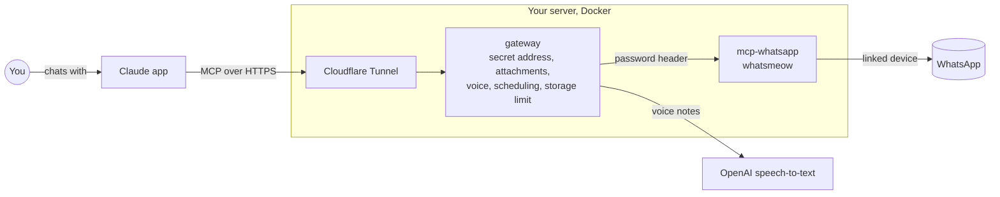

# WhatsApp for Claude

[](https://github.com/GR4Y-dev/whatsapp-for-claude/actions/workflows/tests.yml)
[](LICENSE)

Give Claude your WhatsApp.

A self-hosted connector that lets Claude (claude.ai, the Claude apps, Claude Code) use WhatsApp
**as your own account**: read and search chats, open photos and documents, understand voice
messages, and send, reply, react, edit, delete or **schedule** messages. Claude always shows you
what it's about to do and waits for your "yes".

It builds on [sealjay/mcp-whatsapp](https://github.com/sealjay/mcp-whatsapp) (42 WhatsApp tools)
and adds a small gateway for what that project doesn't do. Everything runs on your own server.
Your WhatsApp login and keys never leave it.

Sister project: [Telegram for Claude](https://github.com/GR4Y-dev/telegram-for-claude).

## Features

**From mcp-whatsapp**
- Chats, messages, contacts and groups, with search and paging; ask your phone for older history
- Send messages, files, voice notes, polls and contact cards; reply, react, edit, delete, mark as read
- Groups: create, rename, members, invite links; block list; privacy settings; "About" text

**Added by the gateway**
- `read_attachment`: photos and stickers, PDFs (scanned ones too), Word, Excel, text and code files
- Voice messages and videos written out (Persian, English, Turkish and more), including the WebM
  voice notes WhatsApp Web records
- `schedule_message`, `list_scheduled`, `cancel_scheduled`: your server sends them, so your phone
  can be off
- **Storage limit** (1 GB by default, your choice): past it, the oldest downloaded files and then
  the oldest messages are removed. Your WhatsApp login is never touched.
- A secret HTTPS address Claude can use, and the WhatsApp pairing page behind the same secret
- `HIDE_TOOLS` to switch off tools you never want Claude to have

## How it works



- **mcp-whatsapp** connects as a linked device (like WhatsApp Web) with
  [whatsmeow](https://github.com/tulir/whatsmeow), keeps a local copy of your messages, and serves
  MCP tools. It's only reachable from the gateway.
- The **gateway** is what Claude talks to. It passes every tool through, adds its own, and is
  reachable only through a free Cloudflare Tunnel on an address with a long random secret.

---

## What you need

- **A Linux server** (Debian or Ubuntu) with root access. 1 GB of memory is enough; the first
  build needs a few GB of free disk for a while.
- **A domain on Cloudflare** (the free plan is fine).
- **A Claude account** (claude.ai).
- **For voice messages:** an **OpenAI API key** (about $0.006 per minute of audio). If you also run
  Telegram for Claude on the same server, the setup offers to reuse its key.

> **Never** paste your tunnel token, OpenAI key or connector address into a chat with any AI.
> You type them only on your server and in claude.ai's settings.

## Setup

### 1. Make a Cloudflare Tunnel (about 3 minutes)

1. **dash.cloudflare.com** → **Zero Trust** (pick the **Free** plan if asked).
2. **Networks → Tunnels → Create a tunnel** → **Cloudflared** → name it `whatsapp` → save.
3. Cloudflare shows install commands. **Copy only the long token** (the part after `--token`).
4. **Next** → **Public hostname**: subdomain `whatsapp`, your domain, type `HTTP`, URL
   `gateway:8000`. Save. Your connector will live at `whatsapp.<your domain>`.
5. **Important:** in your domain's dashboard, **Security → Bots** → turn **Bot Fight Mode off**.
   Otherwise Cloudflare blocks Claude and the connector "can't be reached".

### 2. Get the code and run the setup

```bash
apt-get update && apt-get install -y git
git clone https://github.com/GR4Y-dev/whatsapp-for-claude.git /opt/whatsapp-for-claude
cd /opt/whatsapp-for-claude && bash setup.sh
```

It installs Docker if needed, then asks one at a time for: the **tunnel token** (hidden), your
**time zone**, the **address** from step 1, your **OpenAI key** (optional, hidden) and the
**storage limit** (press Enter for 1 GB). The first build takes 5 to 15 minutes. At the end it
prints two addresses. Treat both like passwords.

### 3. Link your WhatsApp

Open the **pair** address (`https://whatsapp.<your domain>/<secret>/pair`) on a computer. On your
phone: WhatsApp → **Settings → Linked devices → Link a device**, and scan the QR code. Or use
**Link with phone number instead** and the code form on the same page.

### 4. Add it to Claude

claude.ai → **Settings → Connectors → Add custom connector** → name `WhatsApp`, URL: the **mcp**
address. In a chat, check that WhatsApp is switched on (**+** → Connectors), then try
"send a test message to myself on WhatsApp".

---

## Everyday commands

On the server, in `/opt/whatsapp-for-claude`:

| What | Command |
|---|---|
| Is it running? | `docker compose ps` |
| Recent activity and errors | `docker compose logs --tail 50` |
| How much space it uses | `docker compose logs gateway \| grep "WhatsApp data" \| tail -1` |
| Restart (after changing `.env`) | `docker compose up -d` |
| Turn it off / on | `docker compose stop` / `docker compose start` |
| Show the two addresses again | `bash setup.sh` |

## Settings

In `.env`; run `docker compose up -d` after changing it.

| Setting | What it does |
|---|---|
| `STORAGE_LIMIT_MB` | Most space the WhatsApp data may use (default 1024; `0` = no limit) |
| `TIMEZONE` | Your time zone, for scheduled messages |
| `TRANSCRIBE_API_KEY` | OpenAI key for voice messages (empty = Claude can't listen to them) |
| `TRANSCRIBE_URL`, `TRANSCRIBE_MODEL` | Another speech-to-text service, e.g. Groq: `https://api.groq.com/openai/v1/audio/transcriptions` and `whisper-large-v3` |
| `HIDE_TOOLS` | Tools to switch off completely, comma-separated, e.g. `block_contact,unblock_contact,set_privacy_setting,join_group_with_link` |
| `MAX_ATTACHMENT_MB` | Bigger attachments aren't opened (default 20) |

### The storage limit

Every 30 minutes the gateway adds up the WhatsApp data: the message database, downloaded media
and the login. Past 90% of `STORAGE_LIMIT_MB` it removes the oldest downloaded files first (they
download again if Claude needs them), then the oldest messages, until it's at 75%. The database
file then stops growing, because SQLite reuses the freed space.

When you **lower** the limit, the file keeps its size until you compact it once:

```bash
docker compose stop whatsapp && docker compose run --rm --no-deps gateway python gateway.py --compact && docker compose start whatsapp
```

## Updating

You don't need to log in to the server for updates:

- **Automatically:** the setup asks "Update automatically every night?". If you said yes, the
  server checks GitHub around 04:00 (server time) and installs a new version only if its tests
  passed. Turn it on or off later with `bash update.sh --install` / `bash update.sh --uninstall`.
- **Right now, and texts with the result:** if
  [Telegram for Claude](https://github.com/GR4Y-dev/telegram-for-claude)'s call assistant is on
  the same server, send it `/update` (or ask Claude "update the server"). It updates this project
  too and texts you what changed.
- **If an update fails** (for example, the disk is full), it goes back to the version it had
  and tries again at the next update. Projects on the same server update one at a time.

By hand, on the server: `cd /opt/whatsapp-for-claude && bash update.sh`. Your settings and the
WhatsApp link are always kept.

## Troubleshooting

| Problem | Fix |
|---|---|
| Claude says the connector can't be reached | Turn **Bot Fight Mode off** in Cloudflare (Security → Bots) |
| Claude says WhatsApp isn't connected | Open the pair address and scan again (WhatsApp unlinks devices when your phone is offline for about 2 weeks) |
| Chats show numbers instead of names | WhatsApp doesn't share your phone's contact names with linked devices; people with a profile name show up with it |
| Voice messages aren't written out | Add `TRANSCRIBE_API_KEY` to `.env`, then `docker compose up -d` |
| Backspace types strange characters during setup | Ctrl+C, run `stty erase ^H`, start the setup again |
| New tools don't show up in Claude | Switch the WhatsApp connector off and on in the app |

## Security and privacy

The [security review](SECURITY-REVIEW.md) explains the fixes, checks and remaining limits.
`HIDE_TOOLS` applies to gateway tools as well as upstream tools and internal calls. Disabling
`send_message` also prevents new scheduled messages and pauses queued sends. Re-enabling it
uses the existing one-hour grace period, so excessively late messages are not delivered.
Attachment reading accepts files only inside the media store and refuses database files.

- **Cut Claude off any time:** WhatsApp → Settings → Linked devices → tap the device → Log out,
  or remove the connector in claude.ai.
- Both addresses contain a long random secret; every other address returns "Not Found". If one
  leaks, make a new secret (old addresses stop working at once) and put the new mcp address in
  claude.ai:
  ```bash
  sed -i "s/^MCP_SECRET=.*/MCP_SECRET=$(openssl rand -hex 24)/" .env && bash setup.sh
  ```
- The WhatsApp server is only reachable from the gateway, with its own random password.
  Logins and keys live only on your server (`.env` and Docker volumes).
- **WhatsApp's rules:** linked-device tools like this aren't official. Normal personal use is
  usually fine, but bulk or spam-like messaging can get a number banned. mcp-whatsapp has its own
  send-rate limit built in.

## Development

```bash
pip install -r gateway/requirements.txt
python tests/test_gateway.py    # file reading, storage limit, and the gateway against a fake WhatsApp
python -m unittest discover -s tests -p test_security.py
```

## Credits

[mcp-whatsapp](https://github.com/sealjay/mcp-whatsapp) (MIT) ·
[whatsmeow](https://github.com/tulir/whatsmeow) (MPL-2.0) ·
[MCP Python SDK](https://github.com/modelcontextprotocol/python-sdk) ·
[PyMuPDF](https://github.com/pymupdf/PyMuPDF) (AGPL) ·
[Cloudflare Tunnel](https://developers.cloudflare.com/cloudflare-one/connections/connect-networks/)

Not affiliated with WhatsApp, Meta, Anthropic or OpenAI.

## License

[MIT](LICENSE)

## Update efficiency

Updates now reuse unchanged images, retain build cache, and leave other applications'
Docker resources alone. The WhatsApp bridge includes a smaller audio-only ffmpeg build.
See [performance notes](PERFORMANCE.md) for measurements, maintenance and rollback checks.
